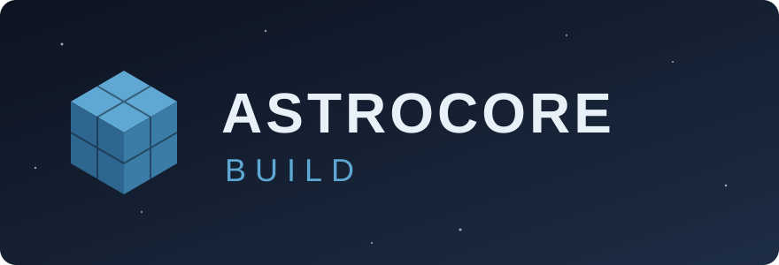

<div class="header" align="center">

</div>

Astrocore Build — многопользовательская игра про космическую станцию в духе Space Station 14,
работающая на [Astrocore Engine](https://github.com/Astrocore-Studio/Astrocore-Engine), нашем
собственном движке на Rust. Мир трёхмерный и воксельный, механики — сервер-авторитарные.

Это основной репозиторий игры. Движок подключается как зависимость и не копируется сюда: в Build
лежит всё, что делает игру игрой — механики, прототипы, карты, интерфейс и ассеты. Тематические
игры — форки этого репозитория: они отключают или заменяют системы и кладут свой контент поверх.

Если вы хотите поднять сервер, делать контент, карты или механики — вам нужен этот репозиторий.

## Ссылки

<div class="header" align="center">

[Astrocore Engine](https://github.com/Astrocore-Studio/Astrocore-Engine) | [Задачи (issues)](https://github.com/Astrocore-Studio/Astrocore-Build/issues) | [План работ](docs/PLAN.md) | [Что сделано](docs/FEATURES.md) | [Решения (ADR)](docs/ADR)

</div>

## Документация

- [docs/PLAN.md](docs/PLAN.md) — план работ мелкими задачами: с чего начать и что делать дальше.
- [docs/FEATURES.md](docs/FEATURES.md) — что уже сделано: механики, форматы, инструменты, управление.
- [docs/SYSTEMS.md](docs/SYSTEMS.md) — как устроены игровые системы и как добавить свою.
- [docs/VOXEL_MODELS.md](docs/VOXEL_MODELS.md) — как нарисовать модель в MagicaVoxel и добавить в игру.
- [docs/ADR](docs/ADR) — архитектурные решения: [отделение от SS14](docs/ADR/0001-separation-from-ss14-and-workflow.md), [воксельная графика](docs/ADR/0002-voxel-graphics.md), [уровни и маппинг](docs/ADR/0003-levels-and-mapping.md).
- [Документация движка](https://github.com/Astrocore-Studio/Astrocore-Engine/tree/main/docs) — мир, сеть, рендер, редактор.

Масштаб мира: 1 тайл = 1 м, куб стены 1 × 1 × 1 м, этаж — два тайла стены, персонаж ростом в тайл.

## Участие

Помощь принимается от всех. Берите любую задачу из [плана работ](docs/PLAN.md) или
[issues](https://github.com/Astrocore-Studio/Astrocore-Build/issues) — у каждой указаны сложность,
где править и как проверить. Многое делается без Rust: прототипы, карты и ассеты — это RON и
картинки. Не бойтесь спрашивать.

Перед отправкой изменений всё должно проходить без ошибок и предупреждений:

```bash
cargo fmt --all -- --check
```

```bash
cargo clippy --workspace --all-targets -- -D warnings
```

```bash
cargo test --workspace --no-fail-fast
```

Новая механика — с тестом на стенде сервера (`crates/gameplay/src/tests.rs`). Решения, меняющие
архитектуру, оформляются ADR в `docs/ADR`.

## Сборка

1. Установите Rust stable (не ниже 1.97.1) через [rustup](https://rustup.rs).
2. Склонируйте репозиторий:
```bash
git clone https://github.com/Astrocore-Studio/Astrocore-Build.git
```
3. Перейдите в папку проекта и запустите сервер с клиентом (движок скачается и соберётся сам,
   версия закреплена в `Cargo.lock`):
```bash
cd Astrocore-Build
```
```bash
scripts/run_all.sh
```

На Windows — `scripts\run_all.bat`. Локальный сервер выдаёт всем админ-ранг: консоль — `` ` ``,
окно маппинга — F5. Другая карта — переменная `ASTRO_MAP=<файл.ron>`. Сервер и клиент отдельно,
ключи и параметры — в [docs/FEATURES.md](docs/FEATURES.md#запуск-и-просмотр).

## Лицензии

Код этого репозитория, как и [Astrocore Engine](https://github.com/Astrocore-Studio/Astrocore-Engine),
распространяется по лицензии [GNU Affero General Public License v3.0 или новее](LICENSE)
(`AGPL-3.0-or-later`). Если вы распространяете игру или запускаете изменённый сервер как сетевой
сервис, AGPL обязывает предоставить исходный код пользователям, включая ваши изменения.

Ассеты распространяются по лицензиям, указанным в их файлах метаданных. Спрайты в `assets/ss14`
взяты из [Space Station 14](https://github.com/space-wizards/space-station-14) и его форков;
лицензия и авторство каждого набора записаны в его `meta.json` (например,
[лом](assets/ss14/Textures/Objects/Tools/crowbar.rsi/meta.json)). Большинство — под
[CC-BY-SA 3.0](https://creativecommons.org/licenses/by-sa/3.0/). Подробности — в
[assets/ss14/LICENSE-ASSETS.md](assets/ss14/LICENSE-ASSETS.md).

> [!NOTE]
> Часть ассетов распространяется по некоммерческим лицензиям
> [CC-BY-NC-SA 3.0](https://creativecommons.org/licenses/by-nc-sa/3.0/) и подобным. Если вы хотите
> использовать проект в коммерческих целях, их нужно удалить или заменить.
