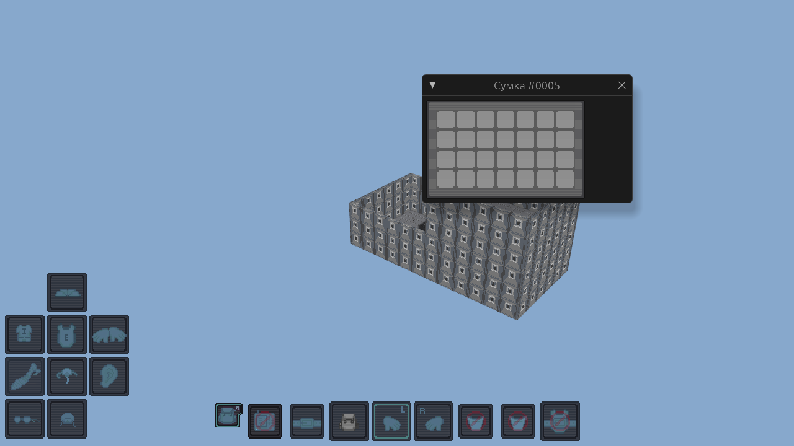
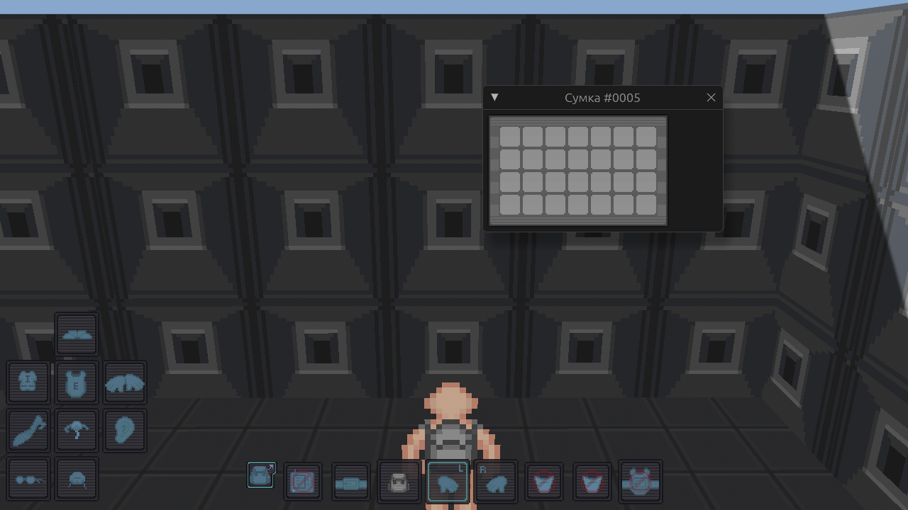
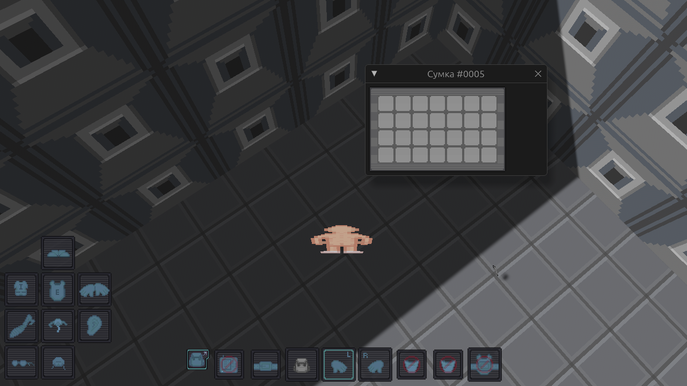
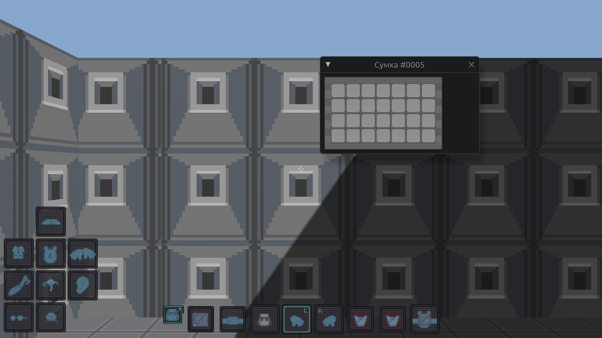
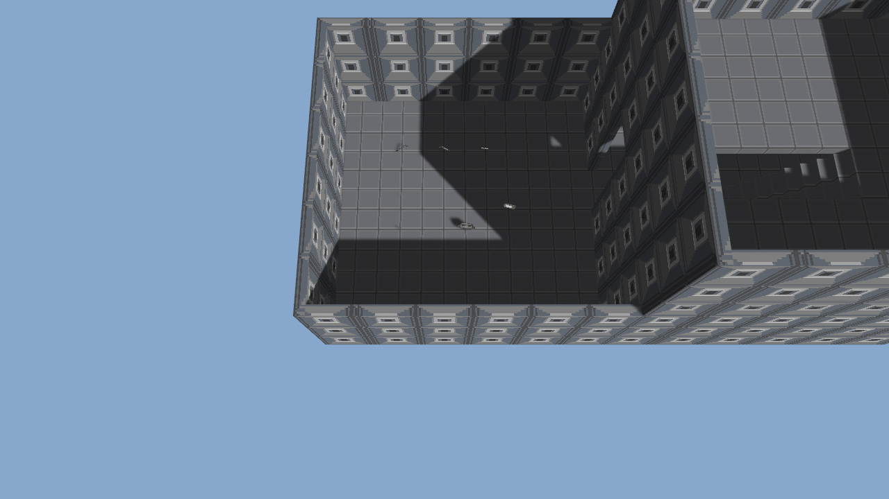
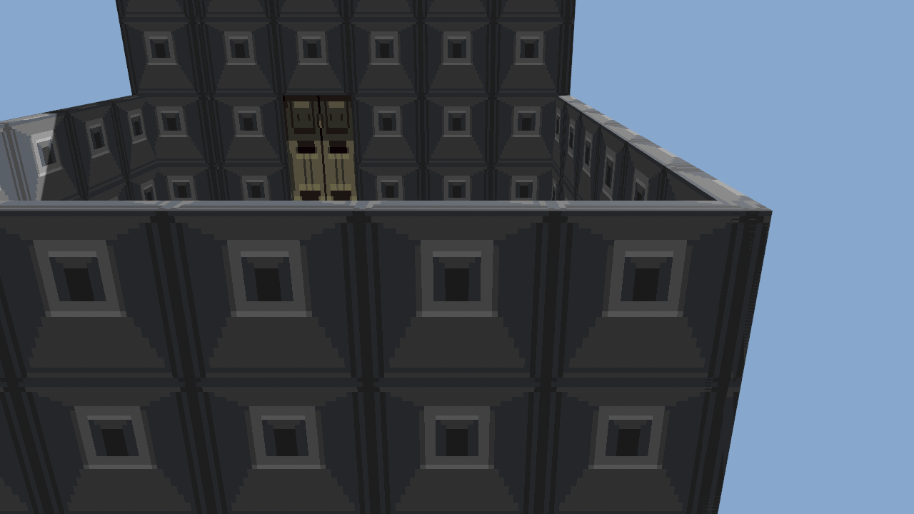
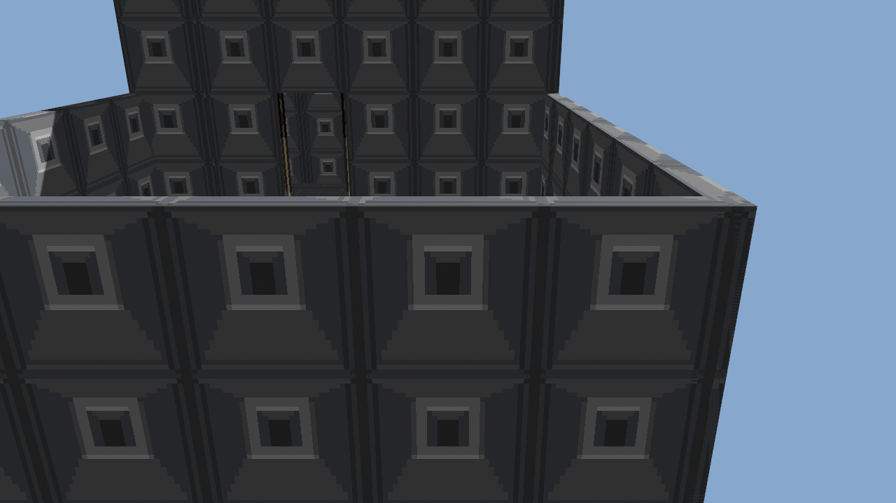
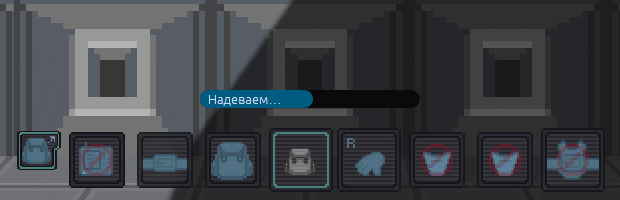
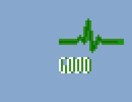

# Astrocore Build

Базовый нейтральный игровой билд на [Astrocore Engine](https://github.com/Astrocore-Studio/Astrocore-Engine):
механики Space Station 14, адаптированные под 3D-мир движка. Тематические игры — форки этого репозитория.

Текущая рабочая карта — **Saltern**. План переноса: [docs/PORTING_PLAN.md](docs/PORTING_PLAN.md).

Работа ведётся в ветке `main`. Движок подключён git-зависимостью на его `main`
(точная версия закреплена в `Cargo.lock`).

## Крейты

| Крейт | Назначение |
| --- | --- |
| `prototypes` | Прототипы сущностей: RON, наследование (несколько родителей), адаптер YAML SS14 |
| `assets` | Наборы спрайтов RSI из SS14: поиск, загрузка, проверка файлов состояний (лицензия — только в отчёте) |

| `polygon` | Нейтральная тестовая карта (две комнаты, дверь, лестница, предметы), манифест рендера |
| `maps` | Формат карты (этажи, конструкции, предметы, спавн) в RON; карта полигона — `content/maps/polygon.ron` |
| `tools` | Импорт: `import-map` (карта SS14 → наш формат), `sync-sprites` (копирование нужных RSI, отчёт о наборах без лицензии) |
| `round` | Раунд: мир полигона с нуля, игровые модули, `GameServer`; новый раунд — чистое состояние |
| `client` (apps) | Клиент билда: клиент движка как библиотека + клавиши рук и окно «Руки и инвентарь» |
| `gameplay` | Игровые механики: руки и предметы (подбор, выброс, выбор руки), модуль `GameModule` |

Логика рук следует Content.Shared/Hands SS14: клик по предмету кладёт его только в **активную**
руку, глагол «поднять» ищет первую свободную (активная первой); дальность взаимодействия 1,5 м от
груди с проверкой, что путь не перекрыт стеной или закрытой дверью; выброс идёт в точку-цель,
обрезанную дальностью и препятствиями, по умолчанию — под ноги; смена руки по кругу в обе стороны.

**Взаимодействия** (Content.Shared/Interaction): команда `interact` с целью — предметом на земле или
дверью. Дальность 1,5 м и видимость проверяются, затем цепочка обработчиков (`InteractionHandler`),
как события SS14: пустая рука — `InteractHand` (подобрать предмет, открыть или закрыть дверь;
запертую рука не открывает), предмет в активной руке — `InteractUsing` цели (положить в сумку на
земле; монтировка с качеством `Prying` вскрывает запертую дверь), затем `AfterInteract` предмета;
`use` — `UseInHand`. Первый обработавший прекращает обход; форк добавляет свои обработчики через
`GameplayModule::with_handler`, не трогая базовые. Дверью управляет движок (коллизия и клиенты
синхронизируются сами).

**Инвентарь и хранилища** (Content.Shared/Inventory и Storage): слоты гуманоида из
`human_inventory_template` (карманы и удостоверение требуют надетой формы, слот на костюме — верхней
одежды; снятая одежда роняет зависимые слоты), в карман идут предметы не крупнее `Small`,
одежда — только в слот своего флага. Хранилище — сетка клеток: у размера предмета своя форма
(Normal 2×2, Large 4×2…), поиск первого места с поворотом на 90°, предел `maxItemSize`, белый и
чёрный списки по тегам и компонентам, вложенная сумка обязана быть строго меньше внешней. Сумку
можно использовать из руки, с тела или лежащую в зоне досягаемости; содержимое остаётся с сумкой.
Руки видны всем (`build.hands`), инвентарь и содержимое сумок — только владельцу (`build.inventory`).

Предметы на земле — авторские объекты мира Engine (`Placement`), поэтому реплицируются и
сохраняются движком; предметы в руках — состояние модуля, реплицируемое как `build.hands`.
Идентификаторы прототипов SS14 (`CrowbarRed`) отображаются в идентификаторы движка
(`ss14:crowbar_red`), коллизии имён — ошибка при запуске.

Проверка на реальных данных: `cargo run -p gameplay --example ss14_items -- <файл.yml из SS14>`.

## Запуск и просмотр

Быстрее всего через скрипты в `scripts/` (Linux — `.sh`, Windows — `.bat`): `run_server`, `run_client`, `run_all` (сервер и клиент вместе). Ключ шифрования создаётся при первом запуске и хранится в `.astro-key` (или берётся из `ASTRO_KEY`), адрес — `ASTRO_ADDR` (по умолчанию `127.0.0.1:7779`). Остальные аргументы передаются программе: `scripts/run_client.sh --third-person`. Ручной запуск:

Сервер раунда (транспорт Lightyear) и клиент движка с текстурами SS14:

```bash
cargo run -p server -- --listen 127.0.0.1:7779 --key <64 hex-символа>
```

```bash
cargo run -p client -- --connect-lightyear 127.0.0.1:7779 --ly-key <тот же ключ> --world-id polygon --render-manifest assets/ss14/render-manifest.json
```

Клиент билда (`apps/client`) — это клиент движка плюс свой плагин: **E** — взаимодействие с ближайшим
предметом или дверью (команда `interact`), **G** — выбросить предмет из активной руки, **X** — сменить
руку, **1/2** — выбрать руку. Худ перенесён с SS14 и рисуется его спрайтами (`assets/ss14/Textures/Interface`): внизу по центру
полоса слотов — `id`, `belt`, `back`, две руки с буквами L/R и подсветкой активной, `pocket1`,
`pocket2`, `suitstorage`; кнопка-рюкзак слева открывает окно одежды в раскладке шаблона SS14
(`uiWindowPos`); сумка открывается окном с сеткой клеток и рамкой хранилища. Слот без нужной
одежды (карманы без формы) помечен значком «заблокировано». Предметы перетаскиваются мышью: между руками (в пустую или с обменом, команда `hands.move`), из руки на слот одежды (надеть) или в окно сумки (положить), со слота или из сумки в ту руку, на которую отпустили (занята — в первую свободную; команды `inv.unequip_to`, `storage.take_to`), со слота на другой слот (`inv.move`: всё или ничего, зависимые слоты не теряются молча), а предмет из руки, отпущенный на свободном месте экрана, падает в точку пола под курсором (луч от камеры до плоскости ступней; сервер проверяет дальность, а без точки предмет падает перед персонажем). Щелчок по слоту по-прежнему надевает предмет из активной руки или снимает надетое; правая кнопка по руке — выбросить, надеть, в сумку; щелчок по предмету в сумке достаёт его. Флаг `--autoplay` сам поднимает
ближайший предмет и надевает его на спину (для проверки интерфейса без ввода).



Тело персонажа собирается клиентом из частей `parts.rsi` SS14 (ноги, торс, голова, руки, цвет кожи
подмешивается, как в SS14) и подставляется движку как `PlayerSprite`: им рисуются чужие игроки и
своё тело (в виде от первого лица оно скрыто). Надетое (`build.worn`, видно всем) и предметы в руках накладываются на тело слоями из RSI предметов — `equipped-BACKPACK`/`equipped-BELT` и `inhand-left/right` — отдельно для каждого из четырёх направлений.





Клиент Build по умолчанию играется **от первого лица** (`--third-person` — вид сзади, **V** переключает на ходу): камера на уровне глаз, свой спрайт скрыт, в центре прицел, предметы из рук показаны крупно по нижним углам. Обзор — **Q/стрелки** или мышь с зажатой правой кнопкой (курсор остаётся свободным для интерфейса).



Манифест рендера (идентификатор → PNG) собирается из
прототипов и `content/materials.ron`: `cargo run -p server -- --write-manifest assets/ss14/render-manifest.json`;
тест следит, чтобы закоммиченный файл не устарел.



Двери анимированы по спрайтам SS14 (`airlock-base.rsi`: closed, opening, open, closing; кадры и
задержки читаются из `meta.json`); состояние двери приходит с сервера, смена цели посреди
анимации разворачивает её без скачка.

| Закрыта | Открыта |
| --- | --- |
|  |  |

Стены, пол и дверь используют спрайты SS14 (`assets/ss14`), предметы на земле — иконки из их RSI.

## Модель раунда

Как в SS14: всё, что случилось в раунде, остаётся в раунде. Состояние игровых модулей (руки,
экипировка, содержимое сумок) живёт в памяти сервера на время раунда и не сохраняется между
запусками — новый раунд начинается с чистого состояния. Предметы на земле лежат в мире движка.

## Ограничения

* Нет «открытых» сумок для другого игрока (обыск), времени на надевание и снятие, сумок-«дыр»,
  стопок предметов, разной формы предметов из прототипа (`Item.shape`).

## Лицензии

Код этого репозитория — MIT (`LICENSE`). Он использует Astrocore Engine (`AGPL-3.0-or-later`) как
зависимость: собранный и распространяемый вместе с движком сервер или клиент подпадает под условия
AGPL движка (в том числе обязанность предоставить исходный код пользователям сетевого сервиса).
Спрайты SS14 в `assets/ss14` — отдельно, под CC-BY-SA (см. ниже).

## Ассеты SS14

`assets/ss14/` — спрайты из space-wizards/space-station-14 под **CC-BY-SA-3.0** (не под лицензией
кода репозитория); подробности и правила — `assets/ss14/LICENSE-ASSETS.md`.

## Проверка

```bash
cargo test --workspace
```

## CI

`.github/workflows/ci.yml` на каждый PR запускает `cargo fmt --check`, `clippy -D warnings` и все тесты.

## Инструменты импорта

```bash
# Карта SS14 (YAML, формат 6/7) → карта Build
cargo run -p tools --bin import-map -- Resources/Maps/saltern.yml content/maps/saltern.ron

# Нужные наборы спрайтов из сборки SS14 (наборы без license/copyright копируются, но попадают в отчёт)
cargo run -p tools --bin sync-sprites -- <space-station-14>/Resources/Textures
```

`import-map` переносит трубы (`GasPipeStraight`, `Bend`, `TJunction`, `Fourway`, `Half`, без дополнительных слоёв `Alt1/Alt2`) как подпольные зоны `gas_pipe` с учётом поворота сущности, предметы и устройства с полем `rot` (четверти оборота против часовой, как у сущностей SS14), пол (клетки не космос и не решётка), стены как рёбра между проходимой клеткой и клеткой со стеной (`Wall*`, окна, решётки), двери по оси прохода, точку появления и предметы, которые есть в содержимом Build; остальное считает и пропускает (отчёт печатается). Ось Y карты SS14 переходит в −Z. Формат клеток чанков (версии 6 и 7) разобран по описанию сериализатора SS14 и проверен тестами на синтетических картах; на настоящих картах SS14 пока не проверялся.

## Действия с таймером (DoAfter)

Надевание и снятие одежды и вскрытие двери монтировкой идут не мгновенно, как `DoAfter` в SS14:

* надевание и снятие берут время из `Clothing` прототипа (`equipDelay`, `unequipDelay`, с; по умолчанию 0 — мгновенно; у рюкзака билда 1,0 и 0,5);
* вскрытие двери монтировкой — 1,5 с (`DoorComponent.PryTime`);
* пока идёт отсчёт, нельзя сойти с места больше чем на 0,3 м (`BreakOnMove`), а условия (предмет в руке, дверь закрыта) перепроверяются при завершении; иначе действие молча прерывается;
* одновременно одно действие; **Esc** в клиенте отменяет его (команда `doafter.cancel`);
* состояние рассылается всем (`build.doafter`: вид и длительность), клиент рисует полоску над руками.

Для этого движок присылает модулям `HookEvent::Tick` каждый тик сервера.



## Другие игроки, ходьба и звук

* Над головой игрока, который надевает, снимает или вскрывает, остальные видят полоску действия (позиция головы проецируется камерой на экран).
* Ходьба: у спрайтов человека в `parts.rsi` кадров шага нет, поэтому персонаж слегка подпрыгивает на каждом шаге; скорость берётся из смещения спрайта, так что одинаково работает для своего тела и чужих.
* Звук (`assets/ss14/Audio`, перечень и лицензии — `ATTRIBUTIONS.md`): шаги (`floor1…5`) на каждом шаге любого игрока с затуханием по расстоянию, `airlock_open`/`airlock_close` при смене состояния двери, шорох (`rustle1…5`) при любом изменении содержимого рук или надетого. Для сборки нужна библиотека ALSA (`libasound2-dev` на Linux); без звукового устройства клиент пишет предупреждение и работает молча.

## Здоровье и урон

По образцу SS14 (`Damage`, `MobState`, `Alerts`); где SS14 решения не даёт, это сказано явно.

* **Урон** копится по видам (`Blunt`, `Slash`, `Piercing`, `Heat`, `Cold`, `Shock`, `Poison`, `Asphyxiation`, `Bloodloss`), группы — `Brute`, `Burn`, `Toxin`, `Airloss`. Лечение уменьшает урон, но не ниже нуля; мёртвого вылечить нельзя.
* **Состояние** по суммарному урону: с 100 — критическое, с 200 — смерть (пороги человека в SS14). Тот, кто не может действовать, **заморожен** (движок: `HookContext::freeze`), его команды игнорируются, всё из рук падает на пол.
* **Части тела** (решение билда, в SS14 урон по частям не делится): голова, торс, две руки, две ноги. Удар приходится на часть под курсором (по высоте и по смещению). Рука с уроном от 50 не работает: выпускает предмет и ничего не берёт (на слоте — значок «заблокировано»); обе ноги от 50 — не ходит; голова от 100 или торс от 150 — смерть, даже если общий урон меньше порога.
* **Кровь и кровотечение** — перенос `BloodstreamSystem` (см. раздел «Кровь»).
* **Удушье и давление** теперь идут от настоящей атмосферы и дыхания, см. раздел «Атмосфера, дыхание, еда и жидкости».
* **Удар** (`combat.attack`, данные — цель и необязательная часть тела): оружие — предмет в активной руке (`MeleeWeapon: (damage, attackRate)`: у лома 8 `Blunt`, у гаечного ключа 4,5, у отвёртки 6 `Piercing`), без него кулак (5). Дальность 1,5 м от груди до груди, прямая видимость, темп ограничен `attackRate`.
* **Лечение** (`combat.heal`): предмет с `Healing` из руки на себя или соседа; действие с таймером (по умолчанию 3 с), расходует **одно применение из стопки** (`Stack.count`, у `Brutepack` и `Ointment` по 10, число показано на предмете). На карте лежат `Brutepack` (травмы −5, перевязка) и `Ointment` (ожоги −5).
* **Видимость:** подробное здоровье (`build.health`: урон, части, кровотечение, удушье) видит только владелец, состояние (`build.mobstate`) — все; лежащих показывает повёрнутый на бок спрайт.

Клиент: **левая кнопка мыши** по игроку — удар, **R** — лечить себя предметом из активной руки, **T** — лечить игрока под курсором. Худ — спрайты SS14: рюкзак-переключатель окна одежды в левом нижнем углу, справа вверху столбец алертов (`Alerts/*.rsi`): анимированный значок здоровья (`health0…4` по доле урона до критического порога, `critical`, `dead`), кровотечение (`bleed1…10`) и «нечем дышать» (`not_enough_oxy`); подсказка к значку здоровья перечисляет урон по частям.



Ограничения: нет воскрешения и призрака (мёртвый остаётся мёртвым до конца раунда), нет переломов и хирургии, а какая сторона тела (левая или правая) задета, определяется приближённо — считается, что цель смотрит на камеру.

## Смерть, призрак и возрождение

* Умерший **оставляет тело** (`Corpse`, спрайт `full` из `parts.rsi`) на месте смерти, всё из рук падает рядом, а сам становится **призраком**: летит сквозь стены и пол без тяжести (движок: `HookContext::set_ghost`), ничего не берёт руками, не бьёт и не лечит. Призраков все видят полупрозрачными и бледными (`build.ghost`).
* Вид призрака — **сверху**: камера поднимается над персонажем и смотрит вниз (приближение `+`/`-`, поворот прежние).
* Через 30 с (выбор билда) призрак может **возродиться** (`ghost.respawn`, кнопка «Возродиться» в клиенте): здоровье сбрасывается, новое тело появляется в точке появления (движок: `HookContext::teleport`), надетое старое тело остаётся лежать у места смерти. Бросать вещи заново не нужно: новое тело пустое.
* Призрак по-прежнему подчиняется сетевому предсказанию: клиент включает полёт сам (`ClientCore::set_noclip`), поэтому движение не дёргается.

Ограничения: призрак не умеет наблюдать за игроками и «преследовать» их, нет полтергейста и чата призраков; тело не тащится и не вскрывается.

## Атмосфера, дыхание, еда и жидкости

Перенос механик SS14 из его исходников (коммит `910154a7`); числа и порядок действий взяты оттуда, отличия указаны.

**Атмосфера** (крейт `atmos`): девять газов с молярной теплоёмкостью из `gases.yml`, смесь `GasMixture` (моли, температура, объём; давление `nRT/V`), клетка 2500 л, воздух 21% O₂ и 79% N₂ при 20 °C (около 101,3 кПа). Обмен газом между соседними клетками — алгоритм LINDA (`Share`, `CompareExchange`, температура и теплоёмкость) с группами возбуждения (разбор через 4 цикла, сворачивание через 16). Цикл атмосферы идёт со скоростью 15 шагов в секунду, по одной стадии на шаг, как в SS14 (девять стадий с Monstermos). Космос — неизменяемая пустая смесь. Геометрия берётся из мира: клетки с полом — воздух, рёбра со стеной, окном или закрытой дверью непроницаемы, открытая дверь пропускает газ; область карты с `atmosphere = space` считается космосом, а открытое ребро наружу вентилирует комнату. Полигон по умолчанию герметичен; пробоину добавляют зоной `zones: [(min, max, floor, metadata: {"atmosphere": "space"})]` в `content/maps/polygon.ron` (пример в комментарии файла). Этажи лежат в одной сетке, лестница (`Stair` с маршем) соединяет нижнюю клетку с клеткой выхода на верхнем этаже, так что воздух ходит между этажами.

**Дыхание** (`body.rs`, `RespiratorSystem`/`LungSystem`/`MetabolizerSystem`): раз в 2 с насыщение падает на 2, вдох и выдох чередуются; вдох берёт 0,5 л воздуха из клетки под ногами, газ переходит в реагенты лёгких (1144 ед. на моль), раз в секунду лёгкие метаболизируют всё: кислород даёт насыщение и превращается в углекислый газ, углекислый газ отнимает насыщение (`Oxygenate: -4`) и травит, плазма травит. Выдох возвращает лёгкие в клетку. Насыщение от −2 до 5; ниже нуля — `Asphyxiation` 1 за каждые 2 с, выше — лечение на 1; после трёх таких тактов загорается предупреждение «нечем дышать». В критическом состоянии не дышат.

**Давление** (`BarotraumaSystem`): раз в секунду, `≤ 20 кПа` — урон `Blunt 0,5 × 4` и `Heat 0,1 × 4`, `≥ 550 кПа` — тот же урон с множителем `min((p/550 − 1) × 4, 4)`; предупреждения при 50 и 385 кПа; защитной экипировки нет.

**Сытость** (`SatiationSystem`, прототипы `NormalSatiationHunger` и `NormalSatiationThirst`): голод до 200 (−1 в минуту), жажда до 600 (−6 в минуту), скорость зависит от порога (Overfed 1,2 · Okay 1,0 · Peckish/Thirsty 0,8 · Starving/Parched 0,6); начальное значение между «Peckish» и «Okay». Предупреждения «хочется есть/пить» и «голод/жажда» — алерты SS14. Урона от голода у человека в прототипах SS14 этой версии нет, поэтому его нет и здесь.

**Еда и питьё** (`IngestionSystem`, `EdibleComponent`, `OpenableComponent`): у предмета есть раствор (`Solution`); использование предмета в руке (**F**) запускает действие «поесть»: каждую секунду 5 единиц из раствора по составу переходят в желудок (150 ед., как в SS14), пока не кончится еда или место; есть и пить можно на ходу. Желудок раз в секунду метаболизирует до трёх реагентов (`Nutriment` — голод +3 за единицу при скорости 1, `Water` — жажда +4 за единицу при скорости 0,5, `Protein`, `Vitamin`, `Sugar` — с их эффектами `Satiate`, лечением травм и ожогов). Съеденная еда исчезает, пустая бутылка остаётся; закрытую бутылку (`Openable`) сначала открывают тем же **F**. На карте лежат `FoodBurgerPlain` и `DrinkWaterBottleFull` (составы и спрайты оттуда).

В клиенте: справа вверху алерты SS14 — давление (`pressure.rsi`), кислород, голод и жажда (`hunger.rsi`, `thirst.rsi`); подсказка к предмету в руке показывает объём раствора и «закрыто».

Выравнивание давления и взрывная разгерметизация Monstermos (`EqualizePressureInZone`, `ExplosivelyDepressurize`, `FinalizeEq`, параметры `mmos_*` по умолчанию) перенесены: пробоина опустошает комнату 5×5 за несколько секунд, цикл атмосферы — девять стадий. **Реакции газов и огонь** (`reactions.rs`, `AtmosphereSystem.Hotspot.cs`, `reactions.yml`): после обмена газом каждая клетка прогоняет смесь через реакции в порядке приоритета: фрезон (производство и охлаждение), аммиак с кислородом, распад закиси азота, горение трития и горение плазмы — формулы и константы из `Content.Server/Atmos/Reactions`, энергия делится на `HeatScale` 8. Горение зажигает `Hotspot`: огонь растёт, пока в клетке есть топливо и окислитель, при заполнении клетки (`Bypassing`) горит прямо в её воздухе и перекидывается на соседей излучением (`FireSpreadRadiosityScale`), гаснет без топлива, кислорода или при остывании ниже 100 °C. Зажечь можно сварочным аппаратом (`Welder` на полу рядом со стартом): **F** в руке зажигает и гасит, зажжённый (700 К) поджигает клетку владельца, если там плазма или тритий с кислородом. Для опытов зона с `"atmosphere": "plasma"` (также tritium, frezon, n2o, ammonia, co2) добавляет газ к воздуху станции.

**Горение персонажей** (`FlammableSystem`, `MobFlammable`): огонь на клетке поджигает стоящего в нём (стопки `log₂(Δ/100) + 1` от температуры выше 100 °C), раз в секунду горящий получает `Heat 1,5 × стопки`, стопки тают на 0,1 в секунду, без кислорода огонь гаснет, а горящее тело само поджигает воздух вокруг. Сбить огонь: **Z** или щелчок по значку огня справа вверху — персонаж 2 с катается неподвижно, стопки тают в 15 раз быстрее. Пламя на клетках и на горящих рисуется спрайтами `fire.rsi` и `onfire.rsi` поверх мира. Не перенесено: защита одежды от огня (`GetFireProtectionEvent`), температура тела и ожоги от нагретого воздуха, поджог предметов, разлитое топливо и огнетушители.

**Трубы и баллоны** (`atmos/pipes.rs`, `gameplay/piping.rs`, `content/prototypes/atmos.ron`; `PipeNet`, `PipeNode`, `GasPressurePumpSystem`, `GasVentPumpSystem`, `GasVentScrubberSystem`, `GasPassiveVentSystem`, `GasValve`, `GasCanisterSystem`, `GasTankSystem`, `GasMaxPressureSystem`): узлы труб с совпадающими направлениями образуют сеть с общей смесью объёмом в сумму узлов (200 л на узел), при перестройке сети газ делится по объёму; на стадии `PipeNet` сети реагируют, на `AtmosDevices` (раз за цикл, 0,6 с) работают устройства. Трубы лежат под полом и на карте задаются зонами 1×1 `metadata: {"gas_pipe": "WE"}` (стороны `N`, `S`, `E`, `W`; `gas_pipe_volume`), устройства — объектами: насос давления, ручной клапан, вентиль (нагнетает до 101 кПа, `PumpPower` 2, блокировка при давлении ниже 80 кПа), скруббер (CO₂, плазма, тритий, водяной пар, аммиак, закись азота, фрезон), пассивный вентиль, разъём и десять баллонов (1500 л, 2769,36 моля газа, как в `gas_canisters.yml`; воздушный — 581,56 O₂ и 2187,79 N₂) с предохранительным клапаном (10 132,5 кПа) и разрывом выше 20 265 кПа с запасом целостности 15. Баллон на разъёме перемешивается с сетью. Управление: **E** пустой рукой — включить насос, вентиль, скруббер или клапан, открыть выпуск баллона; **E** с гаечным ключом — подключить баллон к разъёму, сменить давление насоса (1 / 3 / 10 / 44 атм), направление вентиля, режим скруббера. Переносные баллончики на 5 л (`OxygenTank`, `PlasmaTank`; количество газа — выбор билда, в SS14 их заправляют спавнеры): **F** в руке открывает выпуск (21,3 кПа или 101,3 кПа по прототипу), при перегрузке баллончик лопается и выпускает газ. На карте в восточной комнате стоит демонстрация: баллон кислорода на разъёме → вентиль → вентиль воздуха, рядом скруббер. Не перенесено: питание устройств, интерфейсы с настройками, дозаторы, фильтры, смесители, объёмный насос, регуляторы, термомашины, взрыв лопнувшего баллона (`ExplosionSystem`), подключение баллончика к маске и внутреннее дыхание, космический ветер (в SS14 выключен по умолчанию), сверхпроводимость, температурные эффекты на тело, химия и смешивание (реакции реагентов), посуда и столовые приборы.

**Лужи и разлив** (`puddles.rs`; `PuddleSystem`, `SpreaderSystem`, `Evaporation`, `SlipperySystem`, `SpillableComponent`): разлитое остаётся лужей на клетке пола. В клетке умещается 50 единиц, лишнее раз в секунду растекается (до 16 растеканий в секунду): сначала поровну в свободные соседние клетки, затем выравнивается с соседними лужами; стены и космос лужу не пускают. Испарение раз в секунду по формуле SS14 (`EvaporationAmount 1 × скорость × среднее × доля`: вода 0,3, смазка 0,1, кровь не испаряется), пустая лужа исчезает. Скользкость: лужа меньше 15 ед. не скользкая; иначе скользкой её делают реагенты со `SlipData` (смазка `SpaceLube`, оружейное топливо), порог скорости — среднее по реагентам. Вода в этой версии SS14 не скользкая (только трение 0,4). Поскользнувшийся роняет всё из рук и падает на 2 секунды (оглушение 0,5 с и сбивание 1,5 с); на «суперскользкой» смазке можно поскользнуться ещё раз, не встав. Кровотечение оставляет кровавые лужи (порог 1 ед., `BleedPuddleThreshold`). **V** выливает содержимое открытого предмета из активной руки под ноги; на карте лежит бутылка смазки `SpaceLubeBottle` для опытов. Клиент рисует лужи цветными пятнами на полу (скользкие с обводкой). **Электричество** (крейт `power`, `gameplay/electric.rs`; `PowerNetSystem`, `BatteryRampPegSolver`, `ApcSystem`, `ExtensionCableSystem`): решатель Pow3r перенесён дословно: сети с источниками (`Supply`, нарастание выдачи по `rampRate`/`rampTolerance`), потребителями (`Load`, нехватка делит мощность поровну) и аккумуляторами, которые заряжаются из одной сети и разряжаются в другую; сети решаются снизу вверх, чтобы верхняя видела спрос нижней. Кабели трёх групп (высокое, среднее, АПЦ), лежащие в одной клетке или в соседних, образуют сеть; на карте они задаются зонами `metadata: {"power_cable": "hv" | "mv" | "apc"}`. Устройства — объекты с компонентами `PowerSupplier` (генератор 3 кВт, солнечная панель 1,5 кВт — у SS14 зависит от Солнца, здесь постоянно), `PowerBattery` (подстанция ВН → СН 2,5 МДж, 150 кВт; СМЭС 8 МДж с отдельной клеммой `CableTerminal` на входе; АПЦ СН → сеть АПЦ 50 кДж, 10 кВт) и `ApcPowerReceiver` (по умолчанию 5 Вт, насос 200 Вт). Потребитель подключается к ближайшему кабелю сети АПЦ не дальше 3 клеток; устройство считается запитанным, когда получает всю заявленную мощность. Насосы давления, вентили и скрубберы без питания не работают. Если на карте нет ни кабелей, ни источников, питание не требуется (полигон). Заряд аккумуляторов сохраняется при перестройке сетей. Импортёр переносит кабели `CableHV`, `CableMV` и `CableApcExtension` зонами. На карте «Saltern»: 2 917 клеток с кабелями, 102 панели, 62 аккумулятора (41 АПЦ, 13 подстанций, 8 СМЭС), 174 потребителя, все подключены и запитаны через 3 минуты. Не перенесено: выключатели АПЦ и отключение каналов, перегрузка и срабатывание АПЦ, солнечные панели с отслеживанием Солнца, генераторы на топливе, потребление света и дверей, приборы мониторинга, отключение кабелей и урон током.

**Свет** (`electric.rs`, `apps/client/src/lights.rs`; `Poweredlight`, `PoweredSmallLight`, `LightTube`, `LightBulb`): светильник — потребитель сети АПЦ на 40 Вт с цветом, силой и радиусом из прототипов SS14 (трубка #FFE4CE, 0,8, радиус 10; лампа #FFD1A3, 1,0, радиус 6). Горит, когда получает всю мощность; на карте без проводки горит всегда. Сервер раз в полсекунды шлёт всем палитру видов и точки (до 500, на потолке), клиент держит настоящие источники у 40 ближайших включённых в радиусе 35 м. Когда на карте есть светильники, солнце и общий свет приглушаются — станция освещена лампами. Светильник на полу не рисуется, объектом для **E** не бывает. Не перенесено: спрайты плафонов, перегорание и замена ламп, аварийное освещение, тени от ламп.

**Температура тела** (`TemperatureSystem`, `ThermalRegulatorSystem`, `TemperatureDamage`, `TemperatureSpeed`; значения человека из `species_base.yml`): у тела температура (старт 310,15 К) и теплоёмкость 71,2 кг × 3000 Дж/(кг·К). Раз в секунду тело обменивается теплом с воздухом клетки (проводимость 150 × площадь 2 м², не больше выравнивающего количества; воздух остывает и нагревается телом), терморегулятор живого добавляет 800 − 100 Вт, неявное регулирование до 500 Вт, при отклонении от нормы на 2 К и больше — потение или дрожь до 2000 Вт. Выше 316,15 К идёт урон `Heat` (1,5 × `c/(1 + e^(−0,005·Δ)) − 8`), ниже 273,15 К — `Cold` (0,1 × √(Δ · 64 / 273,15)). Холод замедляет: ниже 293 К скорость 0,9, ниже 280 К — 0,8, ниже 260 К — 0,7. Справа вверху значки «жарко» и «холодно» (`temperature.rsi`, три уровня). Горение греет тело на 37 500 Дж за стопку огня в секунду. Одежда с компонентом `TemperatureProtection: (coefficient)` умножает обмен теплом; в прототипах билда такой одежды пока нет. Не перенесено: `GetFireProtectionEvent`, температура предметов и контейнеров, термоизоляция скафандров.

**Швабры** (`SharedAbsorbentSystem`, `AbsorbentComponent`, `MopItem`, `Bucket`): швабра хранит до 120 ед. раствора; клик левой кнопкой по ёмкости на полу (ведро) или по луже. Ударом по луже мокрая швабра меняет чистую воду на грязь (забирает до `PickupAmount` 120 ед. того, что не вода, и возвращает столько же воды); без воды в швабре или по уже вымытой луже ничего не происходит. По ведру: в пустое швабра выливает грязь (или воду), в непустое берёт воду и отдаёт грязь. Задержка между ударами 1 с (`UseDelay`). Ведро — 360 ед.; `BucketWater` на карте — ведро с водой (в SS14 воду берут из раковин, их здесь нет). Подсказок-«всплывашек» SS14 (нет воды, лужа уже чистая) нет. Не перенесено: продвинутая швабра, спрей, мыло, выливание из брошенного предмета и при ударе, следы ног, реакции реагентов с плиткой и между собой, рывок вперёд при падении и урон по выносливости.

## Кровь, голод и кормление

* **Кровь** (`BloodstreamSystem`, `BloodstreamComponent`): 600 ед., предел 720. Раз в 3 с кровь тянется к норме на 1 ед., кровотечение (`BleedAmount`, до 10) уносит столько же и слабеет на 0,33. Урон открывает кровотечение по коэффициентам `BloodlossHuman` (тупой 0,08, колющий 0,2, режущий 0,25, ожог −0,5 — прижигает, остальное 0), сильный удар может сразу выбить пятую часть урона кровью (шанс — урон к 25). Ниже 90% крови идёт урон `Bloodloss` 0,5 / (0,1 + доля), выше — лечение. Белок добавляет кровь, витамины гасят кровотечение (`ModifyBloodLevel`, `ModifyBleed`), марля с `bloodlossModifier −10` останавливает его. Алерт кровотечения (`bleed0…10`) показывает тяжесть по целой части силы кровотечения.
* **Голод и жажда** действуют так же, как компоненты `SatiationSpeedModifier` и `SatiationDamage`: на «Starving» и «Parched» скорость ×0,75 (значения `BaseHungerThirstSlowdown`, множители перемножаются, движок: `HookContext::set_speed` с предсказанием на клиенте); при нулевой сытости раз в секунду идёт урон `Poison` 1. У человека в прототипах SS14 этой версии эти компоненты не заданы, поэтому включение для человека и величина урона — решение билда.
* **Кормление другого** (`C` в клиенте, команда `feed.other`): тем же укусом по 5 единиц, но за 3 секунды (`ForceFeedDelay`), с прерыванием при движении, по одному укусу; цель должна быть в досягаемости, жива и иметь место в желудке.

## Аварийная атмосфера (как в SS14: `AtmosMonitor`)

Воздушная сигнализация (`air_alarm`) и датчики (`air_sensor`) измеряют воздух в своей клетке раз в секунду
(пороги из SS14: давление, температура, кислород, углекислый газ, плазма, тритий…). Группа берёт самое тяжёлое
состояние монитора. При опасности огнезапоры группы (двери `ss14:firelock`, касающиеся клеток из `links`)
закрываются, вентили выключаются, скрубберы переходят на широкий захват; при норме огнезапоры открываются.
Мониторы без питания не обновляются. Не перенесено: пожарная сигнализация, интерфейс/режимы воздушной
сигнализации (паника, заполнение), собственное предупреждение огнезапора по давлению.

Проверка на Saltern (`cargo test -p round saltern_firelocks saltern_breach -- --ignored --nocapture` с
`ASTRO_MAP_FILE=/tmp/saltern.ron`): станция герметична, все 30 групп в норме, огнезапоры открыты; при проломе
стен у сигнализации с огнезапором он закрывается, остальные остаются открытыми.

Датчик давления огнезапора (`FirelockSystem.Update`): раз в 1,5 с закрытый огнезапор сравнивает воздух по обе
стороны проёма; разность больше 20 кПа или 330 К — он «держит» давление/жар, и рукой его не открыть (в том
числе сигнализацией при возврате в норму); ломик открывает силой. Сам открытый огнезапор по давлению не
закрывается — как в SS14, его закрывает только сигнализация. Не перенесены: предупреждающие лампы и
сообщения игроку, питание огнезапора, множитель времени взлома.

## Точки появления (`SpawnPoint*`)

Импортёр сохраняет каждую точку должности карты как зону `spawn_job` (Captain, Janitor, Latejoin, Passenger…).
Новые игроки появляются на точках `Passenger`/`Latejoin` по очереди (запасная должность SS14), а не в одной
клетке. **Роли пока не перенесены**: в снимке SS14 (`910154a7`) нет ни прототипов должностей и стартового
снаряжения, ни кода станционного спавна, ни таблиц случайных спавнеров (`MaintenanceToolSpawner`,
`RandomSpawner` и др.), поэтому выбор должности, одежда и доступ не воспроизводимы без выдумывания. Для них
нужны `Resources/Prototypes/Roles`, `Entities/Markers/Spawners` и `Content.Server/Station/Systems`.

## Диспозал и конвейеры

Порт по исходникам SS14 `910154a7` (`Content.Shared/Disposal`, `Content.Server/Disposal`,
`Content.Shared/Physics/Controllers/SharedConveyorController`, `SignalSwitchSystem`).

**Диспозал** (`gameplay/src/disposal.rs`): трубы — зоны `disposal_tube` с выходами по порядку прототипа
(`DisposalPipe` S,N; `DisposalBend` S,W; `DisposalJunction` S,W,N; `…Flipped` S,E,N; `DisposalYJunction` S,W,E;
`DisposalXJunction` S,E,N,W; `DisposalTrunk` S + вход). Ёмкость (`DisposalUnit`) принимает предмет из руки
(30 штук максимум), смыв — по пустой руке (кнопка `Engage`) или сам через 30 с; потом 20 с набирает давление
(`PressurePerSecond` 0,05, `FlushDelay` 3 с), питание 5 Вт. Холдер идёт 10 клеток/с, на развилках выбирает
выход как `SelectNextDirection` (обратный пропускается, при трёх выходах — случайный из остальных), зацикленный
холдер срывает трубу и вылетает (`DirectionBias`, `SuspectPipes`, `EscapeChance` 0,2); из открытого конца
предметы вылетают на 1,5 клетки (или в ёмкость на той же клетке). Saltern: 414 труб, 25 ёмкостей, все 26
трасс заканчиваются (проверено).
Не перенесено: звук и интерфейс ёмкости (выброс содержимого, питание), урон на поворотах (в прототипе 0),
оглушение, срыв плитки на выходе, газ в холдере, метки/роутеры/сигнальщики/почта, мобы внутри.

**Конвейеры** (`gameplay/src/conveyor.rs`): лента — `Conveyor: (speed: 2.0)` + питание, поворот `rot`;
`SignalSwitch` (пустая рука) включает ленты из `links` вперёд (`On → Forward`), выключает (`Off → Off`) — так
связаны все 33 ленты Saltern. Предмет над лентой получает скорость `Convey` (к оси, потом вдоль) и
останавливается за краем или у стены. Игроки на ленте не движутся, утилизатор (`Recycler`), реверс и кнопки
не перенесены; у спрайта ленты показан стоящий кадр.

## Торговые автоматы

Порт `SharedVendingMachineSystem` / `VendingMachineSystem` (SS14 `910154a7`). Прототипы 74 автоматов и их наборы
товаров созданы скриптом `scripts/gen_vending.py` (`content/prototypes/vending.ron`). Начальный запас — `startingInventory`
набора с учётом `initialStockQuality`; позиции без прототипа в Build пропускаются, как в `AddInventoryFromPrototype`.
Пустая рука по автомату открывает окно (нужен ток, 200 Вт), нажатие на товар заказывает его: через `ejectDelay`
товар ложится у автомата; пустая позиция или лишний заказ — отказ на 2 с. На Saltern стоит 60 автоматов, но из 786
позиций наборов в Build сейчас есть предметы только для 14 (отвёртка, ломик, сварка, гаечный ключ, перевязки,
ведро, рюкзак): остальные появятся с прототипами еды, напитков и одежды.
Не перенесено: доступ по ID-картам, контрабандный и взломанный запас, перезарядка, поломка автомата и вылет товара
при ударе, звук.

**Консоли** (`Computer*`: связь, грузы, исследования, записи, радар и др.) не перенесены: каждая — отдельная
подсистема SS14 со своим интерфейсом и данными, общего механизма у них нет.

## Должности, снаряжение и спавнеры

Источники — снимок SS14 `910154a7` целиком (Roles, Loadouts, Maps, Markers, Catalog/Fills). Генераторы в `scripts/`:
`gen_roles.py` (должности карты: места из `availableJobs`, снаряжение = набор по умолчанию `RoleLoadout.SetDefault` для
человека без наигранного времени + `startingGear` поверх), `gen_items.py` (1852 предмета с спрайтами, размером, одеждой,
инструментом, хранилищем и `StorageFill`; 982 набора RSI), `gen_spawners.py` (таблицы `EntityTable`, `RandomSpawner`,
`ConditionalSpawner`), `gen_vending.py`.

* **Спавнеры** (`gameplay/src/spawners.rs`): при появлении на карте заменяются предметами по таблице (`ent`/`group`/`all`/
  `nested`, `rolls`, `prob`, `weight`, `amount`), случайная точка в квадрате `offset`; создаются только прототипы, которые
  есть в Build (мобов нет).
* **Должности** (`gameplay/src/jobs.rs`): новичок появляется на точке `Latejoin` (как `SpawnPointSystem` в идущем раунде),
  в окне «Должность» (список по `JobUIComparer`, свободные места) выбирает должность — снаряжение создаётся и надевается
  принудительно в слоты инвентаря, предметы идут в руки и в сумки, контейнеры наполняются по `StorageFill` (`orGroup`,
  `prob`, `amount`/`maxAmount`). Место освобождается при выходе и возрождении. Надетое видно на персонаже (все слоты).
* Не перенесено: удостоверения и доступ (`PDA` — обычный предмет), имя персонажа и внешность, `Special` должностей,
  очередь с приоритетами при старте раунда (в Build раунд идёт всегда, игроки входят «поздно»), точки `SpawnPoint<Job>`
  хранятся как зоны, но не используются.

## Доступ (`AccessReader`, удостоверения, КПК)

Порт `SharedAccessReaderSystem.IsAllowed`: считыватель пускает, если список пуст или хотя бы один его список уровней целиком
есть у персонажа; уровни собираются со всех удостоверений и КПК в руках и на теле (КПК даёт доступ своей карты).
Карта КПК и ID по прототипу (`Access.tags`, `PresetIdCard.job`); при выборе должности карта в слоте `id` получает
доступ должности (`SetAccessToJob`). Двери Saltern: 157 из 217 ограничены (списки из плат дверей, `scripts/gen_access.py`,
и `AccessReader` самих сущностей карты) — рука без доступа не открывает, монтировка по-прежнему вскрывает. Торговые автоматы
с `AccessReader` (охрана и др.) отказывают без доступа.
Не перенесено: консоль выдачи ID и перенастройка доступа, имя/должность на карте, шкафы и ящики с замками (их нет в Build),
журнал доступа, `DenyTags`, ключи записей станции, считыватели у остальных устройств (АПЦ, баллоны и т. п.).

## Шкафы, ящики и замки

Порт `SharedEntityStorageSystem` и `LockSystem` (SS14 `910154a7`); данные — `scripts/gen_spawners.py` →
`content/prototypes/storage.ron` (70 шкафов, ящиков и моргов Saltern: `EntityStorage`, `Lock`, `AccessReader`,
`EntityTableContainerFill`). Закрытый и открытый вид — два прототипа (`X` и `XOpen`) со спрайтами, склеенными из слоя
основы и слоя двери (`EntityStorageVisuals`); открытие меняет прототип объекта.
Пустая рука: запертый шкаф отпирается, если у персонажа есть нужный доступ (`UnlockOnClick`), следующее нажатие открывает —
содержимое ложится вокруг; на открытом нажатие закрывает и забирает предметы в пределах шкафа (до `Capacity`). Клавиша **L**
запирает и отпирает ближайший закрытый шкаф с замком (альтернативное действие SS14). При появлении шкафа его наполняют по
таблице контейнера; открытые на карте шкафы сразу отдают содержимое, замки — как записано на карте (`Lock.locked`).
Не перенесено: сварка и вскрытие замка (`Weldable`, `Emag`), игроки и мобы внутри, газ внутри, подписи-бирки, вид замка
(индикатор заперт/открыт на спрайте), поломка шкафа, морги с лотком, шкафы-хранилища костюмов (`SuitStorage`).

## Консоль выдачи ID и компьютеры

Порт `IdCardConsoleSystem` (SS14 `910154a7`). У консоли два слота — ID с правами и целевая карта. Пустая рука открывает окно
(нужен ток, 50 Вт), ID-карта в руке вставляется в первый свободный слот. В окне: имя и должность (до 32 и 30 символов),
флажки уровней доступа (32 уровня консоли), «Записать», «Вынуть». Менять можно только уровни, которые есть у ID с правами;
уровни, которых консоль не знает, на карте сохраняются; запрос с неизвестным уровнем или чужим правом отклоняется (имя и
должность при этом записываются, как в SS14). Выбранная должность выдаёт карте КПК имя «Новичок» и название должности.
Слоты принимают и КПК (его карту): отдельно вынуть карту из КПК в Build нельзя.
Saltern: 7 консолей ID. Также реализован монитор питания (см. раздел «Мониторинг питания»).
Также работает атмосферная консоль (`ComputerAlert`, см. `docs/atmos-alerts.md`).
Остальные 16 видов компьютеров (`scripts/gen_computers.py`) стоят как неподвижные объекты со
склеенным спрайтом (рама, клавиатура, экран, клавиши) и питанием, но ничего не делают.
Не перенесено: имя персонажа игрока (карта получает «Новичок»), журнал, станционные записи, ИИ-доступ, вынос карт при поломке.

## Химия и медицина

Источники — реагенты и реакции SS14 `910154a7` (`scripts/gen_chem.py`): **425 реагентов** (`content/prototypes/reagents.ron`) и
**224 реакции** (`reactions.ron`: те, что идут без смесителя при комнатной температуре; ещё 81 требует смеситель и 37 — нагрев).
Код — `gameplay/src/chem.rs`, метаболизм — в `body.rs`.

* **Метаболизм по данным** (`MetabolizerSystem`): желудок (`Digestion`), лёгкие (`Respiration`) и новая стадия **кровь**
  (`Bloodstream`, раствор `chemicals` 250 ед.): раз в секунду до 3 реагентов, скорость `metabolismRate`, масштаб `removed / rate`,
  порог `minScale`, вероятность, условия `ReagentCondition` (количество в растворе), `MetabolizerTypeCondition` (человек),
  `MobStateCondition`, `TemperatureCondition`. Реагент без метаболизма: из желудка 0,25 ед./с уходит в кровь (доля 0,5), из крови —
  выводится. Мёртвым действуют только `worksOnTheDead`. Эффекты: `HealthChange`, `EvenHealthChange` и `DistributedHealthChange`
  (лечат только виды, где есть урон — `HealEvenly`/`HealDistributed`), `Satiate`, `ModifyBleed`, `ModifyBloodLevel`, `Oxygenate`,
  `ModifyLungGas`, `AdjustReagent`. Виды урона расширены: `Caustic`, `Radiation`, `Cellular`, группа `Genetic`.
* **Реакции** (`FullyReactSolution`): при переливе в ёмкость раствор реагирует, пока есть что (до 20 проходов, катализаторы остаются).
* **Ёмкости и шприцы:** предмет с `SolutionTransfer` на другой ёмкости переливает заданное количество (из руки в цель, иначе из цели
  в руку); шприц и гипоспрей (`Injector`, режимы `Inject`/`Draw`/`Dynamic`): на ёмкости набирают и вливают, на человеке (клавиши `T`
  на другого, `R` на себя) вводят в кровь с задержкой `mobTime` (5 с у шприца, самому себе вдвое быстрее, лежачему вдвое быстрее; гипоспрей
  мгновенно); «использовать в руке» (`F`) переключает режим. Таблетки и напитки идут в желудок (`Edible`).
* Не перенесено: эффекты дрожи, рвоты, эмоций, статусов, опьянения, скорости, температуры тела (277 из 593 эффектов отброшены генератором);
  реакции со смесителем и нагревом, температура растворов, метаболиты, кровь в шприце (`Draw` у человека), плёнки и пар, остальные газы
  как реагенты, дозировки и всплывающие подсказки.

### Раздатчик реагентов и анализатор здоровья

* **Раздатчик** (`ChemDispenser`, `SodaDispenser`, `BoozeDispenser` Saltern; `gameplay/src/dispenser.rs`): внутри банки `Jug…` с реагентом
  (240 ед.), слот мензурки (`FitsInDispenser`), количество 1…120 (по умолчанию 10), нужен ток. Нажатие на банку переливает выбранное
  количество в мензурку (там идут реакции), «Очистить» опустошает мензурку, «Вынуть» возвращает её в руку.
* **Анализатор здоровья** (`HandheldHealthAnalyzer`; `analyzer.rs`): предмет в руке на человеке (`T` — другого, `R` — себя), 0,8 с
  неподвижности, окно с состоянием, температурой, кровью, кровотечением, суммарным уроном и уроном по группам; обновляется раз в секунду,
  пока цель в 2,5 м.
* Не перенесено: ХимМастер (таблетки и бутылки), центрифуга, нагреватель, криокапсула, дефибриллятор, настройка количества у
  мензурок и шприцев в окне (количество шприца берётся из прототипа, режим переключается `F`), звуки и подсказки.

## Подсказки, звуки и настройка количества

* `build.fx` (`fx.rs`): сервер копит всплывающие подсказки владельцу и звуки по путям внутри `Audio`; клиент показывает подсказки внизу экрана и играет звук с затуханием по расстоянию (14 м). Звуки: автоматы, замки, шкафы, дверь без доступа, диспозал, шприц, анализатор. Файлы копирует `scripts/sync_audio.py` (только CC0/CC-BY, `ATTRIBUTIONS.md` пересобирается).
* `build.chemhand` (`chemhand.rs`): для ёмкости (`SolutionTransfer`) и шприца в активной руке сервер присылает список количеств из прототипа (у ёмкости — `DefaultTransferAmounts` 1…960 до `max`, у шприца — `amounts` режима) и текущее; панель над рукой выбирает командой `chem.amount`.
* Набор крови шприцем (`InjectorSystem.DrawFromBlood`): режим Draw на человеке забирает из его крови выбранное количество (5 по умолчанию), кровь в теле убывает, в шприце появляется `Blood`.

## Дефибриллятор

`Defibrillator` из прототипа (`defib.rs`, `SharedDefibrillatorSystem`): «использовать в руке» включает и выключает (включённый тянет `drawRate` Дж/с из батареи, на разряд нужно `useCharge`; заряд берётся у стартовой `PowerCellMedium`). Предмет на живого запускает `DoAfter` на `doAfterDuration`, на труп — тот же таймер по владельцу тела. Разряд лечит `zapHeal` (в том числе мёртвого), бьёт током `zapDamage` и валит на `WritheDuration`; мёртвый, чьё состояние после лечения не смертельно, оживает на месте трупа (труп убирается). Откат между разрядами — 5 с. Звуки зарядки, разряда, успеха и провала — из `Audio/Items/Defib`.

## Температура растворов, смесители и ХимМастер

* **Температура** (`Solution.temperature`, К): комнатная 293,15; теплоёмкость раствора = объём (у всех реагентов SS14 `specificHeat` 1). Смесь растворов сохраняет тепловую энергию, реакция с `conserveEnergy` тоже. Реакции берут `minTemp`/`maxTemp`; из 342 реакций SS14 в игре все (`gen_chem.py`): 81 со смесителем и 37 с нагревом больше не отбрасываются.
* **Нагреватель** (`SolutionHeater`, плитка): всё с раствором (`FitsInDispenser`), лежащее на плитке, получает `heatPerSecond` Дж/с при питании; реакции идут по мере нагрева.
* **Смесители** (`ReactionMixer`): ложка (`Stir`, 0,5 с) и библия (`Holy`) — предмет из руки по раствору в мире; бумажная центрифуга (`Centrifuge`) — «использовать в руке» на 10 с; шейкер (`Shake`) — клавиша **H** (1 с). Реакции с `requiredMixerCategories` идут, только если смеситель умеет все их виды.
* **Центрифуга и электролизёр** (`SolutionContainerMixer`): слот, окно, «Запустить» на `mixDuration` (10 с и 5 с), пока работают — мензурку не вынуть; по окончании идут реакции своего вида.
* **ХимМастер** (`ChemMaster`): окно с мензуркой на входе, неограниченным буфером, переносом и удалением реагентов (1…120 и «всё»), источником (буфер или мензурка), таблетками (банка на выходе, доза до `pillDosageLimit`, число по свободным клеткам) и бутылками; ярлык показывается в окне. Таблетки и их растворы не реагируют (`canReact: false`). Отличие: вид таблетки (спрайт 1…20) не выбирается — у предметов один спрайт на прототип.
* Звук `soda_shake.ogg` (CC-BY-NC-4.0) взят по явному разрешению владельца проекта (исключение в `sync_audio.py`).
* Фильтры `Storage.whitelist/blacklist` и теги предметов теперь тоже переносятся (`gen_items.py`); тест проверяет, что экипировка всех должностей по-прежнему помещается в свои сумки.

## Криокапсула

`CryoPod` (`cryo.rs`, `SharedCryoPodSystem`, `CryoPodSystem`): пустая рука открывает окно. Там список людей рядом (до 2,5 м), кнопка «Положить» запускает 2-секундное действие (`entryDelay`); пациент замирает на месте капсулы. Выйти — «Вынуть пациента» в окне или клавиша **Z** у самого пациента.
Воздух капсулы (`CryoPodAir`, 2000 л) — узел труб `Device::CryoPod`: на каждом шаге газ реагирует и перемешивается с сетью порта, пациент дышит им и обменивается теплом в 15 раз быстрее (`ConductanceMod`). Без подключённых труб воздуха нет, и пациент задыхается — как в SS14. Мензурка (`FitsInDispenser`) в слоте: кнопки 1/5/10/20 переливают в буфер на 60 ед., и при токе раз в 2 с 1 ед. из буфера уходит в кровь. Окно показывает состояние пациента, газы, температуру и давление.
Отличия: пациент рисуется на своём месте (крышки со спрайтом нет); замок капсулы (`Locked`, ломик) не переносится — он включается только эмагом, которого в билде нет.

## Эффекты реагентов, статусы и метаболиты

`gen_chem.py` теперь переносит **562 эффекта** из 593 (было 316). Добавлены:

* `PopupMessage` — случайная фраза владельцу тела (текст из `Resources/Locale/en-US`), `Emote` — звук эмоции из набора `MaleHuman` (чата в билде нет, эмоция слышна рядом), `Vomit` (`VomitSystem`: желудок целиком в лужу `Vomit`, сытость и жажда меняются, немного химии из крови, замедление), `AdjustTemperature` (тепло телу), `Flammable` и `Ignite`, `Electrocute` (удар `Shock` и оглушение), `CleanBloodstream`.
* **Статусы** (`StatusEffectsSystem`: `Update` продлевает до времени, `Add` прибавляет, `Remove` вычитает или снимает совсем, `Set` задаёт; бессрочные не меняются; `Delay`): `ModifyStatusEffect`, `GenericStatusEffect`, `Jitter`, `Drunk`, `ModifyKnockdown`, `MovementSpeedModifier`. Действуют: `Stunned`/`Knockdown`/`ForcedSleeping` замораживают, `Speed:…` и рвота меняют скорость, `Frail` и `RadiationProtection` — множители урона, `Anticoagulant` (гемофилия) — свёртывание крови, `PressureImmunity` — давление, `Pacified` — нельзя бить. Клиент показывает список статусов, а `Jitter`/`Drunk`/`Woozy` трясут и качают камеру, `Blindness` затемняет экран, `SeeingRainbow`, `Drowsiness`, `NightVision` дают пелену.
* **Метаболиты** (`metabolismStage` `Metabolites`, `MetabolizerComponent`): желудок (3 реагента за шаг) → кровь (сердце, 2) → метаболиты (печень, 1). Всё, что у стадии не имеет обмена, переходит дальше (из крови в метаболиты, `TransferRate` 0,25), в метаболитах лишнее убывает по 1 ед. `metabolites:` в записи реагента превращает переработанное в другой реагент (джин → этанол), так что работает алкоголь: этанол даёт `Drunk`, рвоту и урон.
* Условия `BloodLevelCondition`, `SatiationCondition`, `TagCondition` (тегов у тел нет — «не имеет тега» выполняется всегда).

Не перенесено, потому что в билде нет самой системы (26 эффектов): `Polymorph`, `MakeSentient`, `CureZombieInfection`/`CauseZombieInfection`, `DnaImprint`, `ResetNarcolepsy`, `EyeDamage` (нет глаз), `ReduceRotting` (нет гниения), `StaminaDamage` (нет выносливости), `AdjustAlert` (нет иконок газовых тревог), две фразы без текста в локали. Статусы речи (`Muted`, `Stutter`, `OwO`, `Scrambled`…) хранятся и показываются, но без чата ничего не меняют. Объём раствора метаболитов равен объёму крови, 720 (`BloodstreamSystem.OnMapInit`).

## Мониторинг питания

`ComputerPowerMonitoring` использует действующий решатель энергосистемы Build. Пустая рука открывает
окно при наличии питания; консоль обслуживает одного пользователя. Показания обновляются раз в секунду,
данные окна доступны только его владельцу. Потеря питания, удаление консоли или выход из зоны доступа
закрывают окно. Выбор устройства проверяется сервером.

Перенесены группы генераторов, СМЭС, подстанций и АПЦ, объединение устройств одной коллекции на одинаковых
сетях, выработка, нагрузка и расход батарей, заряд аккумуляторов, источники и нагрузки выбранного
устройства с пропорциональным распределением мощности по SS14. Карта показывает размещение устройств,
три слоя кабелей и сети выбранного устройства; есть выбор на карте, масштабирование и перемещение.
Сведения о группах, коллекциях и значках генерирует `scripts/gen_power_monitoring.py <SS14>` в
`content/prototypes/power_monitoring.ron`; исходный снимок указан в файле. Сетевые данные разделены на
показания, метаданные карты и кабели, каждый компонент ограничен 16 КиБ.

Источники: SS14 `PowerMonitoringConsoleSystem`, `PowerMonitoringDeviceComponent`,
`PowerMonitoringWindow` и `PowerMonitoringConsoleNavMapControl`. Системы событий станции
(`RoguePowerConsumer`/`PowerNetAbnormalities`) в Build отсутствуют, их предупреждения пока не перенесены.
Монитор показывает фактическую модель питания Build: например, существующая постоянная выработка
солнечных панелей 1500 Вт пока не заменена расчётом по положению Солнца. Экран компьютера по-прежнему
использует ранее импортированный статический спрайт; переключение слоёв `ComputerVisuals` — отдельный пробел.

## Нативный запуск Saltern на Windows

Также перенесена консоль атмосферных тревог `ComputerAlert`: 30 воздушных и 15 пожарных сигнализаций,
связанные мониторы (включая вентили и скрубберы), карта областей, показания, приглушение на консоли,
ручная пожарная тревога и сброс, питание и анимации. Подробности исходников, проверок и границ переноса:
[docs/atmos-alerts.md](docs/atmos-alerts.md). Новый импорт сохраняет UID устройств и корректно размещает
настенные сигнализации на гранях 3D-стен. Старую карту нужно повторно импортировать с `-Reimport`.

```powershell
.\scripts\run_saltern.ps1
# Только импорт; повторный импорт существующей карты — явная команда:
.\scripts\run_saltern.ps1 -Mode Import
# Подключение второго клиента к уже работающему серверу:
.\scripts\run_saltern.ps1 -Mode Client -NoBuild
# Выбор нативного Vulkan, если DirectX 12 выдаёт Invalid surface:
.\scripts\run_saltern.ps1 -GraphicsBackend Vulkan
# Проверка изменений соседнего Astrocore-Engine:
.\scripts\run_saltern.ps1 -LocalEngine -GraphicsBackend Vulkan
```

Скрипт использует нативные `server.exe` и `client.exe`, источник SS14 по умолчанию —
`D:\projects\space-station-14`, импортированную карту — `.local/maps/saltern.ron`. Существующая карта
сохраняется; `-Reimport` пересобирает её. Клиент открывается обычным окном Windows, сервер работает в фоне
и останавливается по своему PID при закрытии основного клиента. WSL не используется.
Сервер выполняет начальную инициализацию систем карты до приёма подключений; скрипт ждёт сообщения
о готовности, чтобы построение сетей и запуск спавнеров не прерывали рукопожатие клиента тайм-аутом.

`scripts/_dev_env.ps1` подключает проектные Rust/MinGW из `.local`, если они установлены, и задаёт
пути кэша, сборки и временных файлов только для процесса. Системный PATH и пользовательские профили не
изменяются. Для ручных команд: `. .\scripts\_dev_env.ps1`, затем обычные `cargo fmt`, `cargo clippy`, `cargo test`.
`-LocalEngine` готовит отдельный Cargo-проект в `.local/dev`, который использует исходники Build и
соседнего Engine напрямую. Основные `Cargo.toml` и `Cargo.lock` Build сохраняют закреплённые Git-зависимости.
Для другого расположения движка есть `-EngineRoot`. В Engine подключение теперь создаётся после Startup,
чтобы холодная загрузка графики и ресурсов не расходовала время жизни сетевого токена.
`-Mode Smoke` включает существующий `--autoplay`/`ASTRO_SHOT`, ждёт получения мира и завершает проверочный
клиент после кадров 260/340 с запасом для сохранения снимков. Логи и снимки остаются в `.local`.

Аудит карты и исходных компонентов: `python scripts/audit_saltern.py D:\projects\space-station-14`.
Отчёт `.local/reports/saltern-audit.json` содержит 11 484 сущности, 1 097 групп прототипов и 38 компьютеров
19 видов. Присутствие прототипа в реестре отдельно от подтверждения его функциональности.

## Газовый фильтр и термомашины

* **Фильтр** (`GasFilter`, `GasFilterFlipped`; `GasFilterSystem`): три узла (вход N, боковой W или E, выход S). Включённый берёт `rate` литров в секунду из входа, выбранный газ уходит в боковой узел, остальное — в выход, оба не выше 4500 кПа. На карте фильтр выключен, как в SS14; пустая рука включает, гаечный ключ листает фильтруемый газ (на карте газ берётся из `filteredGas`).
* **Термомашины** (`GasThermoMachineFreezer`, `…Heater`, варианты `Enabled`; `GasThermoMachineSystem`): один узел на юг. Включённая греет или охлаждает газ трубы на `теплоёмкость 5000 × cp` Дж/с с гистерезисом ±2 К и не заходит за целевую температуру. Целевая температура берётся с карты (`targetTemperature`, у холодильника криокапсулы 150 К); гаечный ключ листает 100/150/200/293/350/450 К, пустая рука включает и выключает. Нужен ток.
* Что остаётся из SS14: сеть труб криокапсулы на Saltern теперь вместе с насосом и фильтром и соединена, но газ в неё приходит только по магистрали из атмосферного отсека, когда там подключены баллоны и включены насос и фильтр. Пока их никто не включил, капсула пуста, как и в SS14 в начале раунда.

## Освещение и фонарик

Внутри станции солнца нет: при наличии светильников общий свет почти нулевой (4), солнце выключено, фон чёрный, освещают только лампы (до 40 ближайших, 25 000 лм на единицу `energy` SS14) и фонарик. Фонарик (клавиша **Q**) — прожектор на камере с конусом 0,42 рад, дальностью 18 м и тенями, края экрана затемняются виньеткой. Отладка: `ASTRO_LUMENS` подбирает яркость ламп, `ASTRO_FLASHLIGHT=1` включает фонарик сразу, `ASTRO_SHOT_LIGHTS=<каталог>` снимает кадры.
Не сделано: тени от ламп (только у фонарика), светящиеся плафоны, аварийное освещение. Фонарик пока не привязан к предмету.

## Лобби

Перед раундом игрок попадает в лобби (`gameplay/src/lobby.rs`, по `LobbyGui` SS14): экран на весь кадр с названием станции, номером раунда, таймером до старта (по умолчанию 120 с как `game.lobbyduration`, флаг сервера `--lobby <секунд>`, `0` — без лобби) и кнопкой «Готов». Ожидающий стоит на точке появления, а все его команды, кроме `lobby.ready`, сервер отбрасывает. Когда таймер дошёл до нуля, готовые игроки выходят на станцию и выбирают должность, остальные остаются в лобби с кнопкой «Присоединиться». Не перенесено: чат лобби, выбор персонажа, имена в списке игроков, наблюдатели.

## Конец раунда и перезапуск

`gameplay/src/round_end.rs` (по `GameTicker.EndRound` и `RoundEndSummaryWindow` SS14). Раунд заканчивается, когда весь экипаж (игроки, бравшие должность) погиб, или по пределу времени `--round-secs`. Всем приходит сводка (причина, длительность, кто выжил), поверх игры; через 20 с модуль подаёт `RoundSignal`, сервер строит новый раунд с нуля и вызывает `LyGameHost::replace_game`. Клиенты получают `RoundRestart`, сбрасывают состояние и входят заново без переподключения; лобби нового раунда начинается снова. Не перенесено: цели, имена и достижения, шаттл эвакуации.

## Чат

`gameplay/src/chat.rs` (по `ChatSystem` SS14): каналы «Сказать» (слышно в радиусе голоса 10 м), «Шепнуть» (ясно в 2 м, неразборчиво с заменой букв на `~` до 5 м), «Действие» (`/me`), OOC (слышат все) и чат мёртвых (мёртвые и призраки пишут только друг другу, а слышат всех). В лобби пишут в OOC. Команда `chat` несёт байт канала и текст (до 200 символов, не чаще раза за 0,4 с). Вместо имени персонажа показывается название должности или «Игрок N». В клиенте окно чата слева внизу; клавиша T или клик даёт фокус строке ввода, пока она в фокусе, клавиши не двигают персонажа (`EguiGlobalSettings::enable_absorb_bevy_input_system`). Строка может начинаться с `/me`, `/ooc` или `/w`. Не перенесено: радио, LOOC, имена, прямая видимость.

## Масштаб и потолок

Тайл 1×1 м, человек ростом в тайл (капсула 1,0 м, глаза 0,9 м). Этаж два тайла высотой: импорт карты ставит каждую стену двумя кубами 1×1×1 м друг на друге (текстура не растягивается), а над каждой клеткой пола — потолочную плиту (`StructureKind::Ceiling`, 0,1 м); нижняя грань потолка на 2,2 м, верх на 2,3 м (`FloorDef.height`). Станция в один этаж: пол, стены и пол-крыша. Потолок пока той же текстурой, что пол (`ss14:floor_dark`); балки и перекрытия как на референсе — отдельная работа.

## Каркас взаимодействия

* **Глаголы и осмотр** (`gameplay/src/verbs.rs`, по `SharedVerbSystem`, `ExamineSystemShared`, `HealthExaminableSystem`). Правая кнопка по объекту или игроку открывает меню глаголов: сервер собирает доступные (`Examine`, `Health`, `Pull`/`Stop pulling`), клиент присылает выбор. Shift + левая — осмотр сразу. Осмотр: имя и описание прототипа (`content/descriptions.ron`, `scripts/gen_descriptions.py`, 2274 описания), дальность 16 м без преград, при крите 1,3 м, при смерти 0,75 м. Осмотр здоровья в радиусе 3 м: строки по порогам `health-examinable-carbon.ftl` (Blunt, Slash, Piercing, Heat, Asphyxiation); без ран — «There are no obvious wounds to be seen.». Не перенесено: рассуждения систем (заряд, замок, содержимое), идентичность и маски.
* **Таскание** (`PullingSystem`): глагол `Pull` для игроков и предметов на земле, нужна свободная рука, и она занята (недоступна), пока тащишь (вместо виртуального предмета SS14), цель следует на длине связи `начальное расстояние + 0,15 м`, тащащий идёт на 5% медленнее, связь рвётся при уходе цели дальше 2,5 м, смерти или выходе игрока. Физического соединения нет: цель переставляется в тике.
* **Выносливость и оглушение** (`SharedStaminaSystem`): порог 100, спад 3/с после паузы 3 с; на пороге — оглушение 6 с с падением и выпавшими предметами, потом вставание 2 с, спад ×5; от 60% порога скорость 0,7, от 80% — 0,5; оглушённый не действует. Источник сейчас один: толчок (`CMD_DISARM`, в боевом режиме правая кнопка по игроку; шанс провала 0,75; удачный выбивает предмет из руки, а без предмета даёт 25 выносливости урона). Не перенесено: оружие с уроном выносливости (дубинки), урон от брошенных предметов, звуки и анимации.
* **Усаживание** (`SharedBuckleSystem`): у стульев компонент `Strap` (`furniture.ron`), глагол `Buckle` на 2 с, пристёгнутый стоит в сиденье и не ходит, `Unbuckle` сразу; одно место — один человек. Не перенесено: пристёгивание других людей, кровати, ремни, звуки.
* **Обыск** (`SharedStrippableSystem`): глагол `Strip` у человека рядом открывает окно со слотами и руками цели; щелчок по занятому снимает, по свободному надевает предмет из активной руки; 4 с (`StripTime`, `HandStripDelay`), шаг в сторону прерывает, цель предупреждена («X is removing your Y!»). Не перенесено: скрытный обыск, воры, скрытые слоты, кармашки, наручники.
* **Усталость от ударов:** тупой урон оружия добавляет выносливости `Blunt × bluntStaminaDamageFactor` (0,5 по умолчанию, `SharedMeleeWeaponSystem`); у 120 боевых предметов SS14 (`gen_items.py`) теперь урон и темп из прототипов.
* **Лечь и бросок** (`ToggleKnockdown`, `ThrowingSystem`): `REST` и `THROW` в интерфейсе справа внизу.

## Взрывы

`gameplay/src/explosion.rs` (по `ExplosionSystem.TileFill`): от клетки взрыва кольцо за кольцом (четыре соседа, через открытые рёбра, закрытые двери и стены останавливают) набирается площадь; шаг интенсивности — половина `intensitySlope`, предел на клетку `maxIntensity`, общий объём `totalIntensity`, не больше 500 колец и 3000 клеток. Урон человеку в клетке — `damagePerIntensity` типа взрыва × интенсивность кольца (`content/prototypes/explosions.ron`, `scripts/gen_explosions.py`). Гранаты с `TriggerOnUse` + `TimerTrigger`: использовать в руке — запал, через `delay` взрыв там, где граната лежит, летит или где её держат (`ExplosiveUse`); 23 предмета SS14 несут `Explosive`. Лопнувший баллончик или канистра взрываются (`GasMaxPressureSystem.CheckStatus`): общая интенсивность — корень из энергии газа (давление × объём), тип, спад и предел — по `Explosive` прототипа. Не перенесено: разрушение стен и плитки (`Structural`), урон предметам, отбрасывание, огонь, звук и свет, срабатывание гранат от урона и столкновения, пейджер-детонаторы.

## Стрелковое оружие

`gameplay/src/gun.rs` (по `GunSystem`, `BallisticAmmoProvider`, `ChamberMagazineAmmoProvider`). 24 единицы оружия SS14 с боеприпасами (`gen_items.py`: `Gun`, `Magazine`, `Cartridge`; снаряды и разброс дроби — `content/prototypes/guns.ron`; звуки выстрелов — `gun_sounds.txt`, `sync_audio.py`). Магазинное оружие (пистолеты, автоматы, винтовки) стартует с полным магазином и патроном в патроннике; дробовики и револьверы — со встроенным хранилищем. Выстрел (`CMD_SHOOT`, левая кнопка в боевом режиме; у автоматического огня пока зажата): патрон даёт снаряд (`Projectile.damage`), дробь — несколько со своим разбросом; луч от груди стрелка до первой преграды, попадание в первого человека на пути по росту (голова, торс, ноги). Перезарядка `U` (магазин или патрон из другой руки, старый магазин возвращается в руку), `Y` — достать магазин; счётчик патронов над руками. Энергооружие стреляет от собственной батареи (`BatteryAmmoProvider`: цена выстрела, ёмкость; шокерный снаряд ещё и утомляет); броня (`Armor`, 77 предметов) умножает урон по видам. Не перенесено: полёт снаряда, рикошет и пробитие, рост разброса от стрельбы (`angleIncrease`), режимы огня, зарядка батарей (зарядные станции), гильзы, ускоренная перезарядка из коробки.
